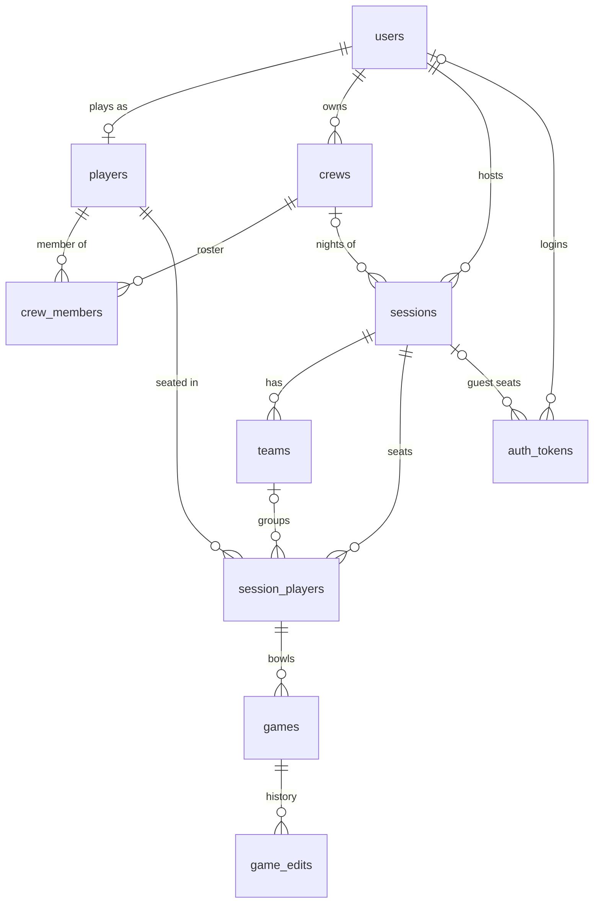
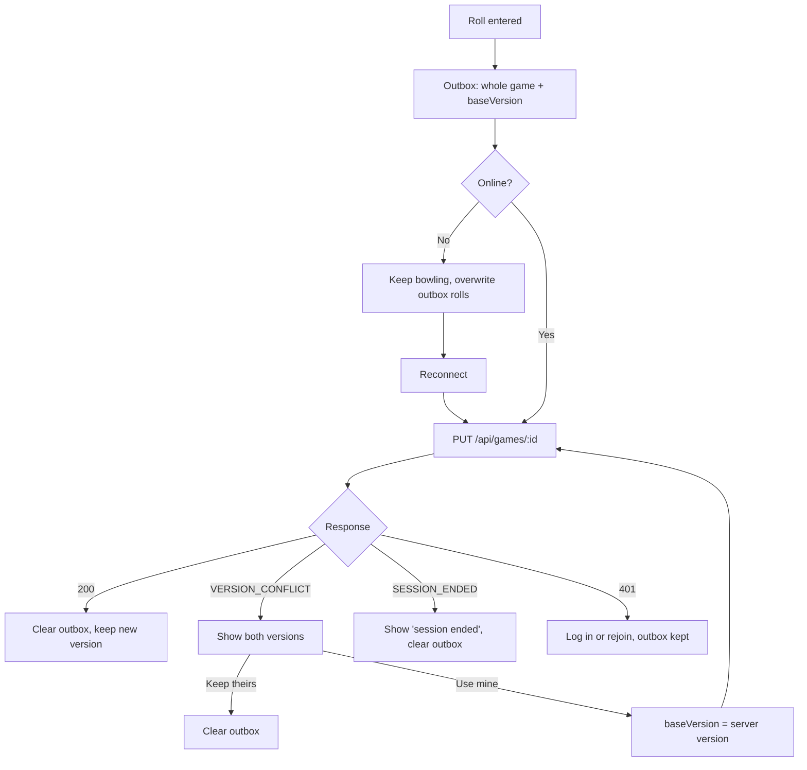

# Architecture

Web app for our friend group to record bowling scores, run team nights like 2v2v2, and keep each crew's history and leaderboard.

## Stack

| Part            | Choice                                                           |
| --------------- | ---------------------------------------------------------------- |
| Frontend        | React 19, Vite 8, Tailwind CSS 4, React Router 8, TanStack Query |
| Backend         | Express 5, Prisma ORM 7, zod                                     |
| Database        | PostgreSQL 18                                                    |
| Runtime         | Node 26 LTS                                                      |
| Tests           | Vitest, supertest                                                |
| Lint and format | ESLint, Prettier                                                 |
| Hosting         | Docker Compose on Krepre's homelab                               |
| Design          | Figma                                                            |

- `package-lock.json` holds the exact versions.
- Prisma stays on 7.x (`npm install prisma@~7.10.1`): npm's `latest` tag points at the 8.0 release candidate, and 8 replaces the migration system. Moving to 8 is its own planned PR.
- TypeScript stays on 6.0: typescript-eslint doesn't support 7 yet.

## Scope

**v1:** tracked as issues in the [v1 milestone](https://github.com/exb-fan-group/bowlathon/milestone/1).

**v1.1:** live updates (SSE), claiming guest history, an edit history view, automatic deploys.

**Later:** stats page (strike rate, spare conversion, trends, summary), head-to-head, handicap, pin-deck entry and split tags, pace projection, sign-in with Google or GitHub.

**Out of scope:** ball tracking, lanes, ball speed, oil and pin patterns, leagues.

## Data model

The schema lives in [`backend/prisma/schema.prisma`](../backend/prisma/schema.prisma). Table names are plural because `user` and `group` are reserved words in Postgres. Login records are `auth_tokens`, so "session" always means a bowling session.

| Table             | Main columns                                                                                                 | Notes                                                                                   |
| ----------------- | ------------------------------------------------------------------------------------------------------------ | --------------------------------------------------------------------------------------- |
| `users`           | username, password_hash, role (`admin`/`member`)                                                             | Username stored lowercase and unique. No email                                          |
| `players`         | name, user_id (nullable, unique)                                                                             | Anyone on a scoresheet. A guest has no user_id. Each account gets its player at sign-up |
| `crews`           | name, owner_user_id                                                                                          | A lasting friend group                                                                  |
| `crew_members`    | crew_id, player_id                                                                                           | The roster, guests included. The owner manages it                                       |
| `sessions`        | crew_id (nullable), host_user_id, join_code, status, anyone_can_edit, started_at, ended_at, last_activity_at | One bowling night. No crew means a one-off night                                        |
| `teams`           | session_id, name, sort_order                                                                                 | Per session, so pairings can change each night                                          |
| `session_players` | session_id, player_id, team_id (nullable), bowl_order                                                        |                                                                                         |
| `games`           | session_id, player_id, game_no, mode (`frames`/`total`), rolls `int[]`, score, complete, version             | Unique on (session_id, player_id, game_no)                                              |
| `game_edits`      | game_id, version, rolls, score, edited_by (player), edited_at                                                | One row per successful save                                                             |
| `auth_tokens`     | token_hash, user_id or session_id + player_id, expires_at                                                    | Logins and guest seats                                                                  |

- **Rolls are the source of truth.** In `frames` mode the server computes `score` and `complete` with the shared scorer and ignores any score the client sends. In `total` mode the typed score is stored as is, and the UI labels the game "score only".
- **Stored vs computed:** `games.score` is stored so SQL can average it. Team totals, series, averages and leaderboards are queries.
- **Stats** use complete games from ended sessions. Average, high game and series include both modes. Strike and spare stats use `frames` games only.
- **Rolls stay an array per game** because a game is saved and versioned as a whole and the bonus math lives in the scorer. Per-roll details (pin-deck entry, split tags) are the point to move to a roll table.
- **Claiming guest history:** one transaction moves the guest player's games, roster and session rows to the user's player, then deletes the guest.
- **Deleting an account** clears `players.user_id`. The player stays as a guest, so crew history keeps its games.

## Scoring

[`shared/src/scoring.ts`](../shared/src/scoring.ts), used by the frontend (live display, keypad) and the backend (validation, stored score):

| Function               | Does                                                                                                     |
| ---------------------- | -------------------------------------------------------------------------------------------------------- |
| `validateRolls(rolls)` | Rejects pins outside 0 to 10, frames over 10, a wrong 10th frame, more than 21 rolls. Partial games pass |
| `scoreGame(rolls)`     | Per-frame marks and running totals (null while a bonus is pending), total, complete                      |
| `pinsStanding(rolls)`  | Pins left for the next roll. The keypad disables higher numbers                                          |

## Sessions and permissions

**Joining**

1. Any logged-in user can host. For a crew session the host must be in the crew. The host picks players (from the roster or new guests), teams and order, and gets a join code.
2. Others enter the code and tap their name in the seat list. A guest gets a seat token tied to that session and player.
3. Logged-in users on the player list get their seat automatically.

Seat picks aren't verified, which is fine among friends. The host can remove a seat.

| Action                                                       | Host | Account in the session       | Guest                        |
| ------------------------------------------------------------ | ---- | ---------------------------- | ---------------------------- |
| Edit own games                                               | yes  | yes                          | yes                          |
| Edit other players' games                                    | yes  | when `anyone_can_edit` is on | when `anyone_can_edit` is on |
| Players, teams, order, edit toggle, lock, end, remove a seat | yes  | no                           | no                           |

`anyone_can_edit` starts on. One phone scoring for everyone needs nothing extra, since the host can edit every game.

**States**

- `open`: anyone with the code can join.
- `locked`: no new joins, scoring continues. The host can unlock.
- `ended`: scores final, code cleared, guest seats revoked, counted in stats.
- A session ends by itself after 6 hours without a save, checked on each request (no cron job), so a host's dead phone doesn't keep the code alive.

**Join codes:** 6 characters without look-alikes (0/O, 1/I/L), unique among open sessions, attempts rate-limited.

## Accounts and auth

- Public sign-up with username and password. Sign-up and login are rate-limited.
- First admin: sign up as `Krepre`, then on the server run `UPDATE users SET role = 'admin' WHERE username = 'krepre';`.
- Password reset: the admin sets a temporary password, which also deletes that user's login tokens.
- Passwords are hashed with bcryptjs.
- Logins and guest seats use a random token in an httpOnly, Secure, SameSite=Lax cookie, stored hashed in `auth_tokens`. Deleting the row revokes it (logout, password reset, removed seat, ended session), which a JWT can't do.
- CSRF: SameSite=Lax plus JSON-only request bodies.

## Live updates and conflicts

**Updates.** Polling: TanStack Query refetches the open session every 3 seconds while the tab is visible, and again on reconnect. Live updates replace the timer with SSE: the server sends "game X changed, version N" and the client refetches through the same query. The SSE route needs `proxy_buffering off` in nginx and a heartbeat shorter than nginx's 60-second read timeout. Its in-memory notifier only works with one API container.

**Saving a game**

- Every save sends the whole game (all rolls) and `baseVersion`, the version the edit started from.
- The server updates with `WHERE id = ? AND version = ?` (Prisma `updateMany`, where a count of 0 means conflict), and validates, saves and writes the `game_edits` row in one transaction.
- A save with the same rolls the server already has returns `200` whatever its version.
- A conflict returns `409 VERSION_CONFLICT` with the current game in the body.
- The client keeps one pending save per game in localStorage (the outbox). Editing while offline overwrites that game's rolls and keeps its `baseVersion`. TanStack Query's built-in offline mutations aren't used: they replay each queued edit, and edit 2 would conflict with edit 1.

## Hosting

- Its own LXC on Krepre's homelab, with a `*.krepre.com` hostname through the Caddy reverse proxy.
- Compose like [GearView3D's](https://github.com/Kreprep/GearView3D/blob/main/docker-compose.yml): `postgres` with a healthcheck; `backend` waits for it and runs `prisma migrate deploy` before starting; `web` (nginx) serves the frontend, proxies `/api`, and is the only published port. Start from GearView3D's [nginx.conf](https://github.com/Kreprep/GearView3D/blob/main/frontend/nginx.conf): SPA fallback, `=404` for missing static files, `no-cache` on `index.html`.
- PostgreSQL 18 keeps its data under `/var/lib/postgresql/18/docker`. Mount the volume at `/var/lib/postgresql`, not `/var/lib/postgresql/data`.
- Express `trust proxy` is 2 (Caddy, then nginx). Otherwise rate limits treat every visitor as one.
- A nightly `pg_dump` runs next to the container backup, to restore only the database or copy real data to a dev machine.

## Design

Visual reference: [Strikemaster](https://www.strikemaster.io/).

- **v1 screens:** keypad entry (X, /, digits, backspace, impossible keys disabled, physical keyboard on desktop), bowling order with "rotate by frame" (after a frame, jump to the next bowler), game tabs, team totals per game with "to beat", and a final-score list for the score-only fallback.
- Mobile first. On desktop (1920×1080 at 100%) the scoreboard and the keypad/team panel sit side by side. Test at 360×800, 390×844 and 1920×1080.
